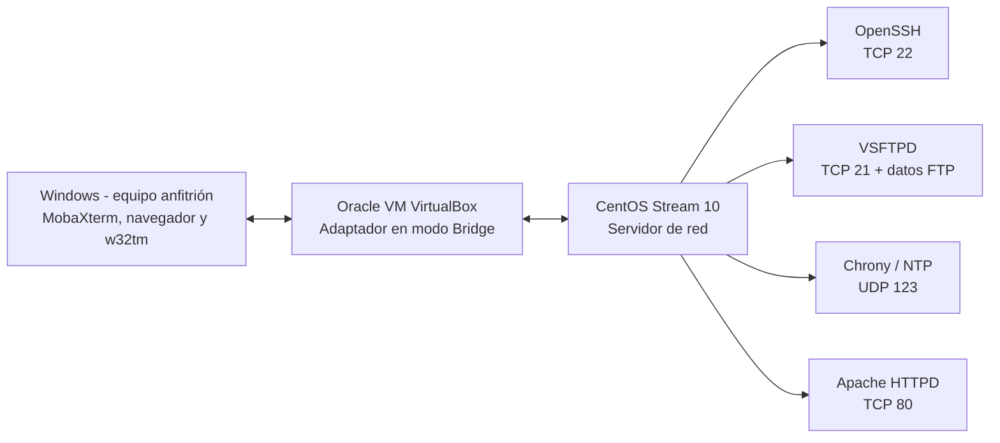

# PRÁCTICA 3: LA LÍNEA DE COMANDO PARA LEVANTAR SERVICIOS EN RED

> **Documento maestro para preparar las seis páginas de la Wiki de GitHub.**  
> Cada sección numerada indica el contenido que se debe copiar a la página correspondiente de la Wiki. Los comandos son procedimientos para ejecutar en el laboratorio; no se presentan como resultados obtenidos hasta que se comprueben en CentOS o Windows.

## Datos de la práctica

| Dato | Información |
|---|---|
| Asignatura | Sistemas Operativos I (Linux) |
| Código | TICS-00087 |
| NRC | 4292 |
| Profesor | Ing. Jonnathan F. Nivicela A. |
| Nivel | Primero |
| Unidad | 1 |
| Horas planificadas (APE) | 4 |
| Laboratorio | C-007, Campus Balzay |
| Periodo académico | Septiembre 2026 - Febrero 2027 |
| Estudiante | Franklin Andrés Luna Arias |
| Sistema | CentOS Stream 10 virtualizado en Oracle VM VirtualBox |
| Cliente | Windows con MobaXterm y navegador |

**Objetivo general:** configurar y validar servicios de red corporativos SSH, FTP, HTTP y NTP en CentOS Stream 10, aplicando controles de acceso, Firewalld y SELinux.

**Logro de aprendizaje vinculado:** conocer el funcionamiento general de los sistemas operativos y su relación con el hardware.

## Cómo publicar este documento en la Wiki

Crea o edita las siguientes páginas en la Wiki nativa del repositorio y copia el bloque correspondiente desde este README:

1. `00-ARQUITECTURA-Y-MATRIZ`
2. `01-SSH`
3. `02-NTP`
4. `03-FTP`
5. `04-HTTP`
6. `05-EVIDENCIAS-Y-TROUBLESHOOTING`

[ Abrir la Wiki del repositorio ](https://github.com/franklinluna-cmyk/SERVIDOR-NTP-CENTOS10/wiki)

**Antes de ejecutar los comandos:** sustituye los valores entre signos angulares, por ejemplo `<IP_CENTOS>` o `<SUBRED_REAL>`, por los datos obtenidos en tu laboratorio. No pegues los marcadores literalmente en la terminal ni en los archivos de configuración. Conserva las direcciones que realmente utilizaste y registra cualquier cambio.

---

# PÁGINA 00 — ARQUITECTURA Y MATRIZ

## 1. Objetivo y alcance

Documentar la topología de red y la relación entre el equipo anfitrión Windows, VirtualBox y la máquina virtual CentOS Stream 10. La máquina virtual proporciona los servicios SSH para administración, NTP para sincronización horaria, FTP para transferencia de archivos y HTTP para publicación web.

## 2. Topología lógica



El adaptador en modo puente permite que la máquina virtual participe en la red física como un equipo independiente. La dirección IP puede cambiar si se asigna por DHCP; por eso se debe consultar antes de conectarse desde Windows.

## 3. Datos del entorno

| Elemento | Dato registrado | Observación |
|---|---|---|
| Sistema operativo | CentOS Stream 10 | Servidor virtualizado |
| Virtualización | Oracle VM VirtualBox | Adaptador Bridge |
| Cliente | Windows y MobaXterm | Administración y transferencia |
| FTP | VSFTPD | Usuario registrado: `ftpandres` |
| IP usada en una prueba FTP | `10.21.165.107` | Confirmar la IP vigente antes de repetir pruebas |
| Directorio FTP | `/home/ftpandres/archivos` | Carpeta destinada a transferencias |
| NTP | Chrony | Archivo `/etc/chrony.conf` |
| Red registrada en una configuración NTP | `192.168.1.0/24` | Verificar que corresponda a la red real del cliente |
| HTTP | Apache HTTPD | Directorio `/var/www/html` |

Los datos de IP y subred proceden de registros de pruebas diferentes. No se debe asumir que `10.21.165.107` y `192.168.1.0/24` corresponden a una misma configuración de red. La subred de la directiva `allow` en Chrony debe coincidir con la red real desde la que consultará Windows.

Para consultar los datos de red actuales en CentOS:

```bash
hostname -I
ip -br -4 address
ip route
```

En Windows:

```bat
ipconfig
```

## 4. Matriz de puertos y servicios

| Servicio | Protocolo | Puerto | Función |
|---|---|---:|---|
| SSH | TCP | 22 | Administración remota segura |
| NTP | UDP | 123 | Sincronización horaria |
| FTP - control | TCP | 21 | Autenticación y comandos FTP |
| FTP - datos activo | TCP | 20 como puerto de origen del servidor | Canal de datos iniciado por el servidor |
| FTP - datos pasivo | TCP | Rango definido en VSFTPD, por ejemplo 30000-30100 | Canal de datos iniciado por el cliente |
| HTTP | TCP | 80 | Publicación de la página web |
| HTTPS | TCP | 443, solo si se configura TLS | Publicación web cifrada |

**Nota sobre FTP activo:** el servidor utiliza normalmente el puerto TCP 20 como puerto de origen al iniciar el canal de datos hacia el cliente. No significa que siempre deba abrirse TCP 20 como puerto de entrada al servidor. En una configuración con firewall con seguimiento de estado, se debe comprobar el comportamiento de la conexión y la regla del servicio FTP. Para FTP pasivo sí se debe permitir el rango de puertos de datos configurado en VSFTPD.

**Nota sobre HTTPS:** la práctica solicita HTTP. El puerto 443 se documenta como opcional y no debe indicarse como habilitado si no se implementó TLS.

## 5. Matriz de Firewalld

| Servicio | Regla de Firewalld | Puerto asociado |
|---|---|---|
| SSH | `--add-service=ssh` | TCP 22 |
| NTP | `--add-service=ntp` | UDP 123 |
| FTP | `--add-service=ftp` | FTP de control |
| FTP pasivo | `--add-port=30000-30100/tcp` | Rango pasivo elegido |
| HTTP | `--add-service=http` | TCP 80 |
| HTTPS | `--add-service=https` | TCP 443, solo si se configura TLS |

Los cambios deben aplicarse en la zona asociada a la interfaz de red de CentOS. Consultar primero. Los comandos siguientes usan la zona predeterminada; si la interfaz aparece en otra zona, añade `--zone=<ZONA_ACTIVA>` a los comandos de Firewalld para aplicar la regla en esa interfaz:

```bash
sudo firewall-cmd --get-active-zones
sudo firewall-cmd --get-default-zone
sudo firewall-cmd --list-all
```

## 6. Matriz SELinux

| Servicio | Criterio de seguridad |
|---|---|
| SSH | Mantener SELinux activo; la configuración estándar de OpenSSH no requiere desactivar políticas. |
| NTP | Mantener SELinux activo y revisar AVC únicamente si Chrony registra una denegación. |
| FTP | Usar usuario dedicado, shell `/sbin/nologin`, directorio limitado y el booleano `ftp_home_dir` si la política lo requiere para permitir acceso al HOME. |
| HTTP | Mantener el contenido web con contexto `httpd_sys_content_t` y permisos de lectura. |

No se debe desactivar SELinux para resolver errores. Tampoco se debe aplicar `chmod 777` ni habilitar `ftpd_full_access` como solución general.

## 7. Comandos generales de consulta

```bash
hostnamectl
hostname -I
ip -br address
ip route
whoami
systemctl status sshd
systemctl status chronyd
systemctl status vsftpd
systemctl status httpd
sudo firewall-cmd --list-all
getenforce
```

---

# PÁGINA 01 — SSH

## 1. Arquitectura y requisitos

El servicio SSH permite administrar CentOS Stream 10 desde Windows mediante una conexión remota cifrada.

- Servidor: CentOS Stream 10.
- Cliente: Windows con MobaXterm.
- Servicio: OpenSSH Server (`sshd`).
- Protocolo: TCP.
- Puerto: 22.
- Red de VirtualBox: adaptador Bridge.

## 2. Despliegue y configuración

Instalar OpenSSH Server y Firewalld:

```bash
sudo dnf install -y openssh-server firewalld
```

Habilitar e iniciar ambos servicios:

```bash
sudo systemctl enable --now firewalld
sudo systemctl enable --now sshd
```

Comprobar el estado:

```bash
systemctl is-active firewalld
systemctl is-active sshd
```

Permitir SSH de forma permanente en la zona activa:

```bash
sudo firewall-cmd --permanent --add-service=ssh
sudo firewall-cmd --reload
sudo firewall-cmd --list-services
```

Consultar la dirección IP del servidor:

```bash
hostname -I
```

En MobaXterm, crear una sesión SSH con estos datos:

| Campo | Valor |
|---|---|
| Remote host | IP vigente de CentOS |
| Port | 22 |
| Username | Usuario administrativo autorizado |
| Network protocol | SSH |

Introducir la contraseña únicamente en la ventana de autenticación de MobaXterm. No incluir contraseñas en la Wiki ni en capturas.

## 3. Aseguramiento de seguridad: SELinux y Firewalld

Firewalld debe permitir el servicio SSH y no se debe abrir un rango de puertos innecesario.

```bash
sudo firewall-cmd --list-all
sudo ss -lntp | grep ':22'
getenforce
```

SELinux debe mantenerse en modo `Enforcing`. La instalación estándar de OpenSSH no requiere desactivar SELinux ni cambiar sus etiquetas para escuchar en el puerto 22.

Como medida de seguridad, usar una cuenta autorizada, una contraseña robusta y no permitir el acceso remoto de cuentas de servicio como `ftpandres`.

## 4. Pruebas de aceptación y troubleshooting

| Prueba | Comando o acción | Criterio de aceptación |
|---|---|---|
| Servicio | `systemctl is-active sshd` | Devuelve `active` |
| Dirección IP | `hostname -I` | Muestra la IP vigente |
| Puerto | `ss -lntp` | Se observa SSH escuchando en TCP 22 |
| Firewall | `firewall-cmd --list-services` | Aparece `ssh` |
| Cliente | Conexión SSH desde MobaXterm | Se obtiene una terminal de CentOS |

**Problema 1: Connection refused.** El servicio no está escuchando o no se encuentra iniciado.

```bash
sudo systemctl status sshd
sudo journalctl -u sshd -n 50 --no-pager
```

Solución: iniciar SSH, revisar sus registros y comprobar el puerto de escucha.

**Problema 2: Connection timed out.** Puede existir una IP incorrecta, una red Bridge desconectada o una regla de firewall que bloquea el puerto.

```bash
hostname -I
ip route
sudo firewall-cmd --list-all
```

Solución: utilizar la IP actual de CentOS, comprobar la conectividad y permitir SSH en la zona correcta.

**Problema 3: Permission denied.** Las credenciales no son válidas o el usuario no tiene autorización.

Solución: comprobar el nombre de usuario, restablecer la contraseña si corresponde y verificar que la cuenta esté autorizada.

**Evidencia que se debe incorporar:** captura de MobaXterm con la sesión SSH abierta, estado activo de `sshd` y regla SSH de Firewalld.

---

# PÁGINA 02 — NTP

## 1. Arquitectura y requisitos

Chrony proporciona sincronización de hora mediante el protocolo NTP. CentOS Stream 10 actúa como servidor de hora y Windows como cliente.

- Servidor: CentOS Stream 10.
- Servicio: Chrony (`chronyd`).
- Archivo: `/etc/chrony.conf`.
- Protocolo: UDP.
- Puerto: 123.
- Cliente: Windows Time Service (`w32time`).

## 2. Despliegue y configuración del servidor Chrony

Instalar Chrony:

```bash
sudo dnf install -y chrony
```

Realizar una copia de seguridad del archivo antes de editarlo:

```bash
sudo cp /etc/chrony.conf /etc/chrony.conf.bak
```

Editar la configuración:

```bash
sudo nano /etc/chrony.conf
```

Conservar las líneas válidas de fuentes de hora que ya existan, por ejemplo:

```text
pool 2.centos.pool.ntp.org iburst
```

Agregar la directiva `allow` con la subred real del equipo cliente:

```text
allow <SUBRED_REAL>
```

Ejemplo únicamente ilustrativo: `allow 192.168.1.0/24` sirve solo cuando Windows realmente pertenece a esa subred. No se debe conservar ese ejemplo si la red Bridge utiliza otro segmento.

La directiva `allow` autoriza a los clientes de esa red a consultar el servidor NTP. No habilita la administración remota de Chrony.

Habilitar e iniciar el servicio:

```bash
sudo systemctl enable --now chronyd
sudo systemctl restart chronyd
sudo systemctl status chronyd
```

Permitir NTP en Firewalld:

```bash
sudo firewall-cmd --permanent --add-service=ntp
sudo firewall-cmd --reload
sudo firewall-cmd --list-services
```

Verificar que Chrony escucha en UDP 123:

```bash
sudo ss -lunp | grep ':123'
```

## 3. Aseguramiento de seguridad: SELinux y Firewalld

- Abrir únicamente el servicio NTP (UDP 123) para los clientes que correspondan.
- Limitar las consultas con la directiva `allow` a la subred real.
- Mantener SELinux en modo `Enforcing`.
- No abrir el puerto UDP 323 para la práctica de sincronización: ese puerto se utiliza para administración remota de Chrony y no es necesario para que Windows consulte NTP.

Comprobaciones:

```bash
getenforce
sudo firewall-cmd --list-all
sudo journalctl -u chronyd -n 50 --no-pager
```

## 4. Pruebas de aceptación en CentOS

Consultar las fuentes de tiempo:

```bash
chronyc sources -v
```

Consultar el seguimiento del reloj:

```bash
chronyc tracking
```

Consultar el estado del servicio:

```bash
systemctl is-active chronyd
```

Criterios de aceptación:

- `chronyd` se encuentra activo.
- Chrony dispone de una fuente de tiempo válida y alcanzable.
- En `chronyc tracking`, el estado de salto (`Leap status`) indica `Normal` cuando la sincronización se ha completado.
- En `chronyc sources -v`, se identifica una fuente seleccionada, normalmente marcada con `^*` cuando ya se ha seleccionado una fuente.
- Firewalld permite NTP y la red autorizada corresponde al cliente Windows.

## 5. Configuración del cliente Windows

Abrir CMD como administrador. Antes de cambiar la configuración, consultar el origen y el estado actual:

```bat
w32tm /query /source
w32tm /query /status
```

Configurar Windows para consultar la IP real del servidor CentOS:

```bat
w32tm /config /manualpeerlist:"<IP_CENTOS>,0x8" /syncfromflags:manual /update
```

Reiniciar el servicio de hora y solicitar la sincronización:

```bat
net stop w32time
net start w32time
w32tm /resync /rediscover
```

Comprobar el origen y el estado:

```bat
w32tm /query /source
w32tm /query /status
w32tm /query /configuration
```

El origen debe mostrar la dirección configurada del servidor CentOS y el estado debe mostrar información de una sincronización reciente. Si el equipo pertenece a un dominio institucional, una directiva de grupo puede controlar el origen de hora y sobrescribir la configuración manual; en ese caso se debe revisar la política aplicada.

**Importante sobre la prueba de desfase:** para demostrar la corrección, se puede alterar temporalmente la hora del reloj de Windows con autorización y después ejecutar la resincronización. Cambiar solo la zona horaria modifica la hora visualizada, pero no equivale a alterar el instante UTC que sincroniza NTP. Al finalizar, dejar el reloj y la zona horaria correctos.

## 6. Troubleshooting de NTP

**Problema 1: Chrony no encuentra fuentes.**

```bash
chronyc sources -v
sudo journalctl -u chronyd -n 50 --no-pager
```

Solución: comprobar la conexión a Internet, el nombre de las fuentes configuradas y el estado de `chronyd`.

**Problema 2: Windows no logra sincronizar.**

```bash
sudo firewall-cmd --list-all
sudo ss -lunp | grep ':123'
```

Solución: verificar UDP 123, la subred de `allow`, la dirección IP actual y la conectividad entre Windows y CentOS.

**Problema 3: Windows mantiene otro origen de hora.**

```bat
w32tm /query /source
w32tm /query /configuration
```

Solución: revisar la lista manual de pares, las políticas de dominio y volver a solicitar la sincronización después de aplicar la configuración correcta.

**Evidencias que se deben incorporar:** configuración de `/etc/chrony.conf` sin datos sensibles, estado de `chronyd`, salidas de `chronyc sources -v` y `chronyc tracking`, regla Firewalld y resultados de `w32tm /query /source` y `w32tm /query /status` en Windows.

---

# PÁGINA 03 — FTP

## 1. Arquitectura y requisitos

VSFTPD permite transferir archivos entre CentOS Stream 10 y Windows mediante MobaXterm.

- Servidor: CentOS Stream 10.
- Servicio: VSFTPD.
- Cliente: MobaXterm.
- Usuario dedicado: `ftpandres`.
- Puerto de control: TCP 21.
- Datos activos: canal iniciado por el servidor, normalmente con puerto de origen TCP 20.
- Datos pasivos: rango TCP 30000-30100 en el ejemplo de esta guía.
- Directorio de transferencia: `/home/ftpandres/archivos`.

FTP tradicional no cifra las credenciales ni el contenido. En esta práctica debe utilizarse únicamente dentro de la red de laboratorio. Para sistemas de producción se debe preferir SFTP o FTPS. SFTP utiliza SSH y no es el mismo protocolo que FTP.

## 2. Despliegue y configuración

Instalar VSFTPD:

```bash
sudo dnf install -y vsftpd
```

Crear el usuario si todavía no existe:

```bash
getent passwd ftpandres || sudo useradd -m ftpandres
sudo passwd ftpandres
```

Asignar una shell sin acceso interactivo:

```bash
sudo usermod -s /sbin/nologin ftpandres
```

Verificar la cuenta y sus grupos:

```bash
getent passwd ftpandres
id ftpandres
sudo -l -U ftpandres
```

El usuario no debe pertenecer al grupo administrativo `wheel` ni tener reglas sudo asignadas.

Crear la estructura de directorios. El directorio raíz del usuario será propiedad de root para que no sea modificable, mientras que la carpeta `archivos` será propiedad del usuario FTP:

```bash
sudo chown root:root /home/ftpandres
sudo chmod 755 /home/ftpandres
sudo install -d -o ftpandres -g ftpandres -m 750 /home/ftpandres/archivos
```

Editar la configuración de VSFTPD:

```bash
sudo nano /etc/vsftpd/vsftpd.conf
```

Asegurar que las siguientes directivas estén presentes una sola vez y con estos valores. Si ya existen, editar la línea existente:

```ini
anonymous_enable=NO
local_enable=YES
write_enable=YES
local_umask=077
chroot_local_user=YES
pasv_enable=YES
pasv_min_port=30000
pasv_max_port=30100
port_enable=YES
```

El rango 30000-30100 es una propuesta para esta práctica; debe quedar igual en Firewalld y debe verificarse que no esté ocupado por otro servicio. No se debe afirmar que ya estaba configurado hasta aplicarlo y comprobarlo.

Si la autenticación falla por la validación de shells de PAM, comprobar primero si el archivo PAM de VSFTPD incluye `pam_shells.so`:

```bash
grep -n 'pam_shells.so' /etc/pam.d/vsftpd
grep -n '/sbin/nologin' /etc/shells
```

Solo si PAM utiliza `pam_shells.so` y rechaza la shell asignada, registrar `/sbin/nologin` en `/etc/shells`:

```bash
grep -qxF /sbin/nologin /etc/shells || echo /sbin/nologin | sudo tee -a /etc/shells
```

La shell sigue siendo `nologin`; agregarla a `/etc/shells` no la convierte en una terminal interactiva.

Habilitar e iniciar el servicio:

```bash
sudo systemctl enable --now vsftpd
sudo systemctl restart vsftpd
sudo systemctl status vsftpd
```

## 3. Aseguramiento de seguridad: Firewalld y SELinux

### Firewalld

Permitir el servicio FTP y el rango pasivo:

```bash
sudo firewall-cmd --permanent --add-service=ftp
sudo firewall-cmd --permanent --add-port=30000-30100/tcp
sudo firewall-cmd --reload
sudo firewall-cmd --list-all
```

El servicio FTP de Firewalld permite el canal de control. El rango TCP pasivo debe coincidir con `pasv_min_port` y `pasv_max_port` de VSFTPD.

Para revisar la definición del servicio FTP:

```bash
sudo firewall-cmd --info-service=ftp
```

En modo activo, el servidor inicia el canal de datos desde el puerto 20 hacia un puerto del cliente. La conexión puede depender del firewall del cliente y del seguimiento de conexiones FTP. No se debe abrir indiscriminadamente TCP 20 como entrada al servidor; se debe comprobar el flujo real y las reglas de la zona activa.

### SELinux

Mantener SELinux en modo `Enforcing`:

```bash
getenforce
getsebool -a | grep -E 'ftp|ftpd'
ls -Zd /home/ftpandres /home/ftpandres/archivos
```

Para permitir el acceso FTP a directorios personales, comprobar el booleano `ftp_home_dir`:

```bash
getsebool ftp_home_dir
```

Si el booleano existe, está desactivado y la prueba confirma una denegación SELinux al acceder al HOME, habilitarlo de forma persistente:

```bash
sudo setsebool -P ftp_home_dir on
```

Para el modo pasivo, comprobar si la política instalada ofrece `ftpd_use_passive_mode`:

```bash
getsebool ftpd_use_passive_mode
```

Solo si el booleano existe y se confirma una denegación SELinux relacionada con la apertura de puertos pasivos, habilitarlo:

```bash
sudo setsebool -P ftpd_use_passive_mode on
```

No activar `allow_ftpd_full_access` ni `ftpd_full_access` como primera solución: son permisos amplios. Tampoco utilizar `ftpd_anon_write` para resolver el acceso de un usuario local; ese booleano está destinado a escenarios de escritura FTP anónima sobre contenido público etiquetado apropiadamente.

Consultar denegaciones:

```bash
sudo ausearch -m AVC -ts recent
```

Si la política instalada no dispone de alguno de los booleanos indicados, no se debe ejecutar ese comando; documentar el resultado de `getsebool -a` y revisar la política disponible en el sistema.

## 4. Pruebas de aceptación

### Comprobación del servidor y del usuario

```bash
systemctl is-active vsftpd
getent passwd ftpandres
id ftpandres
sudo -l -U ftpandres
ls -ld /home/ftpandres /home/ftpandres/archivos
```

Criterios:

- VSFTPD está activo.
- La cuenta utiliza `/sbin/nologin`.
- La cuenta no pertenece a `wheel` ni tiene privilegios sudo.
- El directorio raíz pertenece a root y la carpeta `archivos` pertenece a `ftpandres`.

### Prueba desde MobaXterm en modo pasivo

Crear una sesión FTP con la IP vigente del servidor, puerto 21 y usuario `ftpandres`. Activar el modo pasivo en las opciones de la sesión.

1. Iniciar sesión.
2. Navegar al directorio `archivos`.
3. Subir un archivo llamado `prueba.txt`.
4. Descargar el mismo archivo a Windows.
5. Comparar el contenido del original y del descargado.

Comprobar desde CentOS:

```bash
ls -l /home/ftpandres/archivos
cat /home/ftpandres/archivos/prueba.txt
```

Contenido de prueba propuesto:

```text
Prueba FTP de Franklin Andrés Luna Arias.
```

El contenido debe coincidir con el que se haya subido realmente.

### Prueba en modo activo

Cambiar la opción de transferencia del cliente FTP a modo activo y repetir la subida y descarga. El resultado depende también de que el firewall del cliente permita la conexión de datos iniciada por el servidor.

Registrar por separado el resultado de la prueba activa y pasiva. Si el modo activo no puede validarse por las restricciones de red del equipo anfitrión, documentar el error y la condición que lo impide; no marcarlo como exitoso.

## 5. Troubleshooting FTP

**Problema 1: el cliente no conecta al servidor.**

```bash
sudo systemctl status vsftpd
sudo firewall-cmd --list-all
hostname -I
sudo journalctl -u vsftpd -n 50 --no-pager
```

Solución: verificar IP, puerto de control TCP 21, servicio activo y regla FTP.

**Problema 2: el usuario no puede iniciar sesión con nologin.**

```bash
getent passwd ftpandres
grep -n 'pam_shells.so' /etc/pam.d/vsftpd
grep -n '/sbin/nologin' /etc/shells
sudo journalctl -u vsftpd -n 50 --no-pager
```

Solución: revisar la shell, la configuración PAM, la contraseña y que la cuenta no esté bloqueada o incluida en las listas de denegación de VSFTPD.

**Problema 3: inicia sesión, pero no puede subir o descargar archivos.**

```bash
ls -ld /home/ftpandres /home/ftpandres/archivos
getsebool -a | grep -E 'ftp|ftpd'
sudo firewall-cmd --list-all
sudo ausearch -m AVC -ts recent
```

Solución: comprobar permisos DAC, booleano `ftp_home_dir`, contexto SELinux, rango pasivo idéntico en VSFTPD y Firewalld y el modo de transferencia utilizado.

**Evidencias que se deben incorporar:** configuración de VSFTPD sin contraseñas, cuenta y shell, grupos y permisos, estado del servicio, reglas Firewalld, salida SELinux y pruebas de subida y descarga en modo pasivo y activo.

---

# PÁGINA 04 — HTTP

## 1. Arquitectura y requisitos

Apache HTTPD publica una página web personalizada almacenada en CentOS Stream 10. El equipo Windows accede a ella mediante un navegador.

- Servidor: CentOS Stream 10.
- Servicio: Apache HTTPD (`httpd`).
- Cliente: navegador de Windows.
- Herramienta de prueba: `curl`.
- Directorio web: `/var/www/html`.
- Protocolo: HTTP.
- Puerto: TCP 80.

## 2. Despliegue y configuración

Instalar Apache y curl:

```bash
sudo dnf install -y httpd curl
```

Habilitar e iniciar Apache:

```bash
sudo systemctl enable --now httpd
sudo systemctl status httpd
```

Permitir HTTP en Firewalld:

```bash
sudo firewall-cmd --permanent --add-service=http
sudo firewall-cmd --reload
sudo firewall-cmd --list-all
```

Crear una imagen SVG local para incluirla en la página. El siguiente comando genera un archivo de imagen dentro de la raíz web, sin depender de una descarga externa:

```bash
sudo tee /var/www/html/infraestructura.svg > /dev/null <<'SVG'
<svg xmlns="http://www.w3.org/2000/svg" width="900" height="420" viewBox="0 0 900 420">
  <defs>
    <linearGradient id="fondo" x1="0" y1="0" x2="1" y2="1">
      <stop offset="0" stop-color="#10243a"/>
      <stop offset="1" stop-color="#176b87"/>
    </linearGradient>
  </defs>
  <rect width="900" height="420" rx="28" fill="url(#fondo)"/>
  <g fill="none" stroke="#b9e8f4" stroke-width="5" opacity=".9">
    <path d="M220 210 H360 M540 210 H680"/>
    <path d="M450 110 V155 M450 265 V310"/>
    <circle cx="450" cy="210" r="55"/>
  </g>
  <g fill="#e7f7fb">
    <rect x="95" y="120" width="125" height="180" rx="12"/>
    <rect x="680" y="120" width="125" height="180" rx="12"/>
    <rect x="385" y="70" width="130" height="40" rx="8"/>
    <rect x="385" y="310" width="130" height="40" rx="8"/>
    <rect x="405" y="185" width="90" height="50" rx="8" fill="#24a3b8"/>
  </g>
  <g fill="#176b87">
    <rect x="112" y="140" width="91" height="38" rx="5"/>
    <rect x="112" y="190" width="91" height="38" rx="5"/>
    <rect x="112" y="240" width="91" height="38" rx="5"/>
    <rect x="697" y="140" width="91" height="38" rx="5"/>
    <rect x="697" y="190" width="91" height="38" rx="5"/>
    <rect x="697" y="240" width="91" height="38" rx="5"/>
  </g>
  <g fill="#ffffff" font-family="Arial, sans-serif" text-anchor="middle">
    <text x="450" y="42" font-size="25" font-weight="bold">INFRAESTRUCTURA DE RED</text>
    <text x="157" y="335" font-size="20">CLIENTE</text>
    <text x="743" y="335" font-size="20">SERVIDOR</text>
    <text x="450" y="245" font-size="18" font-weight="bold">RED</text>
    <text x="450" y="97" font-size="15">HTTP / FTP / NTP</text>
    <text x="450" y="382" font-size="16">CENTOS STREAM 10 - APACHE HTTPD</text>
  </g>
</svg>
SVG
```

Crear la página principal personalizada:

```bash
sudo tee /var/www/html/index.html > /dev/null <<'HTML'
<!DOCTYPE html>
<html lang="es">
<head>
  <meta charset="UTF-8">
  <meta name="viewport" content="width=device-width, initial-scale=1">
  <title>Servidor Web - CentOS Stream 10</title>
  <style>
    body {
      margin: 0;
      padding: 40px 18px;
      background: #eef3f8;
      color: #203040;
      font-family: Arial, sans-serif;
      text-align: center;
    }
    main {
      max-width: 850px;
      margin: auto;
      padding: 30px;
      background: white;
      border-radius: 18px;
      box-shadow: 0 8px 28px rgba(20, 45, 70, .12);
    }
    h1 { color: #145b78; }
    img { width: 100%; height: auto; border-radius: 12px; }
    .dato { margin: 12px 0; }
    footer { margin-top: 25px; color: #637789; }
  </style>
</head>
<body>
  <main>
    <h1>Servidor Web - CentOS Stream 10</h1>
    <h2>Franklin Andrés Luna Arias</h2>
    <p class="dato"><strong>Asignatura:</strong> Sistemas Operativos I (Linux)</p>
    <p class="dato"><strong>NRC:</strong> 4292</p>
    <p class="dato"><strong>Servicio:</strong> Apache HTTPD</p>
    <p>Esta página demuestra la publicación de contenido personalizado mediante el protocolo HTTP.</p>
    
    <footer>Práctica 3 - Laboratorio C-007 - Campus Balzay</footer>
  </main>
</body>
</html>
HTML
```

Si la práctica se entrega en grupo, agregar en la página los nombres completos de los demás integrantes.

Establecer permisos de lectura adecuados y restaurar los contextos SELinux:

```bash
sudo chmod 755 /var/www/html
sudo chmod 644 /var/www/html/index.html
sudo chmod 644 /var/www/html/infraestructura.svg
sudo restorecon -Rv /var/www/html
```

## 3. Aseguramiento de seguridad: Firewalld y SELinux

Firewalld debe permitir HTTP (TCP 80). HTTPS (TCP 443) solo se habilita cuando se instala y configura un certificado TLS y el sitio está preparado para HTTPS.

Comprobar el contexto de los archivos:

```bash
getenforce
ls -Zd /var/www/html
ls -Z /var/www/html
```

El contenido estático debe conservar el contexto `httpd_sys_content_t`. Si se copiaron archivos desde otra ubicación y tienen etiquetas incorrectas, restaurar el contexto:

```bash
sudo restorecon -Rv /var/www/html
```

Apache necesita leer la página y la imagen; no necesita permisos de escritura sobre el contenido estático. No utilizar `chmod 777`.

## 4. Pruebas de aceptación y troubleshooting

Comprobar la sintaxis de Apache:

```bash
sudo apachectl configtest
```

Resultado esperado: `Syntax OK`.

Comprobar el servicio:

```bash
systemctl is-active httpd
```

Resultado esperado: `active`.

Comprobar la respuesta HTTP local:

```bash
curl -I http://localhost
curl -sS -o /dev/null -w 'HTTP %{http_code}\n' http://localhost/
```

Resultado esperado: código HTTP `200`.

Desde Windows, abrir un navegador y escribir:

```text
http://<IP_CENTOS>
```

La página debe mostrar el nombre completo del estudiante, información de la práctica y la imagen `infraestructura.svg`.

**Problema 1: la página no abre desde Windows.**

```bash
hostname -I
sudo systemctl status httpd
sudo firewall-cmd --list-all
```

Solución: comprobar IP, modo Bridge, servicio Apache y regla HTTP.

**Problema 2: Apache no inicia.**

```bash
sudo apachectl configtest
sudo journalctl -u httpd -n 50 --no-pager
```

Solución: corregir errores de sintaxis o conflictos de configuración antes de reiniciar el servicio.

**Problema 3: aparece HTTP 403 Forbidden o no se visualiza la imagen.**

```bash
ls -lZ /var/www/html
sudo restorecon -Rv /var/www/html
sudo ausearch -m AVC -ts recent
```

Solución: comprobar permisos de lectura, nombre exacto del archivo de imagen, contexto SELinux y registros AVC. No desactivar SELinux.

**Evidencias que se deben incorporar:** `apachectl configtest`, estado activo de HTTPD, respuesta HTTP 200, página abierta desde Windows y contexto `httpd_sys_content_t` de los archivos.

---

# PÁGINA 05 — PRUEBAS DE ACEPTACIÓN Y TROUBLESHOOTING

## 1. Objetivo

Registrar las comprobaciones de los servicios SSH, NTP, FTP y HTTP, junto con las medidas de respuesta ante los incidentes más comunes. Este documento funciona como Runbook técnico de operación y validación.

## 2. Matriz de aceptación

| Servicio | Prueba | Criterio de aceptación | Evidencia |
|---|---|---|---|
| SSH | Estado de `sshd` y conexión MobaXterm | Servicio activo y sesión remota funcional | Terminal y MobaXterm |
| NTP | `chronyc sources -v` y `chronyc tracking` | Fuente seleccionada y Leap status Normal | Terminal CentOS |
| NTP cliente | `w32tm /query /source` y `/status` | Windows utiliza CentOS y muestra sincronización reciente | CMD Windows |
| FTP | Inicio de sesión y transferencia pasiva | Subida y descarga correctas | MobaXterm y archivo |
| FTP | Inicio de sesión y transferencia activa | Transferencia correcta o limitación de red documentada | MobaXterm |
| FTP seguridad | `getent passwd`, `id`, `sudo -l` | Shell nologin y sin privilegios sudo | Terminal CentOS |
| HTTP | `apachectl configtest` y `curl` | Syntax OK y HTTP 200 | Terminal CentOS |
| HTTP cliente | Navegador Windows | Página personalizada e imagen visibles | Navegador |
| Firewalld | `firewall-cmd --list-all` | Solo servicios y puertos requeridos | Terminal CentOS |
| SELinux | `getenforce`, `ls -Z` | Enforcing y etiquetas correctas | Terminal CentOS |

Los criterios anteriores describen los resultados que se deben comprobar. Completar el registro con los valores y capturas reales obtenidos en el laboratorio.

## 3. Registro de evidencias

| N.º | Evidencia | Archivo o captura |
|---:|---|---|
| 1 | Topología lógica Mermaid | Captura de la arquitectura renderizada |
| 2 | SSH activo | Estado de `sshd` |
| 3 | SSH desde Windows | Sesión MobaXterm conectada |
| 4 | NTP en CentOS | `chronyc sources -v` |
| 5 | Seguimiento NTP | `chronyc tracking` |
| 6 | NTP en Windows | `w32tm /query /source` y `w32tm /query /status` |
| 7 | Usuario FTP | Shell, grupos y privilegios |
| 8 | Permisos FTP | Propiedad del HOME y carpeta `archivos` |
| 9 | FTP pasivo | Subida y descarga de `prueba.txt` |
| 10 | FTP activo | Resultado de la prueba en modo activo |
| 11 | Seguridad FTP | Firewalld y SELinux |
| 12 | Apache | `apachectl configtest` y estado del servicio |
| 13 | HTTP | Respuesta HTTP 200 |
| 14 | Página personalizada | Página e imagen visibles desde Windows |
| 15 | Seguridad HTTP | Contextos SELinux de `/var/www/html` |

Las capturas deben ser reales, legibles y tomadas durante las pruebas. No se deben utilizar imágenes simuladas ni resultados inventados. Ocultar contraseñas, tokens o información privada antes de subirlas al repositorio.

## 4. Runbook de troubleshooting: tres incidentes prioritarios

### Incidente 1. El firewall bloquea la conexión a un servicio

**Síntoma:** SSH, FTP o HTTP no responden desde Windows aunque el servicio esté activo.

**Diagnóstico:**

```bash
sudo firewall-cmd --get-active-zones
sudo firewall-cmd --list-all
sudo ss -lntup
hostname -I
```

**Resolución:** identificar la zona activa, comprobar la IP actual y habilitar únicamente el servicio requerido. Ejemplo para HTTP:

```bash
sudo firewall-cmd --permanent --add-service=http
sudo firewall-cmd --reload
```

Para SSH o NTP, utilizar `--add-service=ssh` o `--add-service=ntp`. Para FTP pasivo, abrir únicamente el rango configurado en VSFTPD.

**Validación:** repetir la conexión desde Windows y comprobar la regla con `firewall-cmd --list-all`.

### Incidente 2. SELinux impide el acceso a archivos FTP o HTTP

**Síntoma:** FTP autentica, pero no permite transferir; o Apache responde con HTTP 403.

**Diagnóstico:**

```bash
getenforce
sudo ausearch -m AVC -ts recent
ls -lZ /home/ftpandres/archivos
ls -lZ /var/www/html
```

**Resolución FTP:** revisar primero permisos del sistema de archivos y el booleano `ftp_home_dir`. Activarlo solo si existe y la política lo requiere:

```bash
getsebool ftp_home_dir
sudo setsebool -P ftp_home_dir on
```

Si se necesita publicar archivos recibidos por FTP, es más seguro recibirlos en `/home/ftpandres/archivos` y copiarlos al directorio web mediante un procedimiento administrativo controlado. No se debe conceder escritura general a VSFTPD sobre `/var/www/html` ni relajar el contexto HTTP para evitar una denegación.

**Resolución HTTP:** restaurar los contextos estándar de la carpeta web:

```bash
sudo restorecon -Rv /var/www/html
```

No desactivar SELinux ni otorgar permisos generales de escritura.

**Validación:** repetir la transferencia FTP o consultar la página HTTP y revisar nuevamente los registros AVC.

### Incidente 3. Desfase horario afecta registros y validación TLS

**Síntoma:** las marcas de tiempo de los registros son incorrectas o un navegador rechaza certificados por fechas que no parecen válidas.

**Diagnóstico en CentOS:**

```bash
systemctl status chronyd
chronyc sources -v
chronyc tracking
timedatectl
```

**Diagnóstico en Windows:**

```bat
w32tm /query /source
w32tm /query /status
```

**Resolución:** comprobar las fuentes de Chrony, la directiva `allow`, la regla UDP 123 y que Windows consulte la IP correcta del servidor. Solicitar una nueva sincronización:

```bat
w32tm /resync /rediscover
```

**Validación:** confirmar que Chrony esté sincronizado, que el reloj de Windows tenga la hora correcta y que los registros presenten marcas de tiempo coherentes. No modificar la fecha manualmente como solución permanente.

## 5. Lista de comprobación previa a la entrega

- [ ] La Wiki contiene las páginas 00, 01, 02, 03, 04 y 05.
- [ ] El diagrama de arquitectura se visualiza correctamente.
- [ ] Las matrices de puertos, Firewalld y SELinux están completas.
- [ ] SSH permite la conexión desde MobaXterm.
- [ ] Chrony está sincronizado y Windows utiliza CentOS como fuente.
- [ ] FTP utiliza una cuenta dedicada, sin shell interactiva ni privilegios administrativos.
- [ ] El rango pasivo está definido igual en VSFTPD y Firewalld.
- [ ] Se documentaron los resultados de FTP activo y pasivo.
- [ ] Apache muestra los nombres completos del estudiante y la imagen.
- [ ] Las pruebas de aceptación tienen resultados reales.
- [ ] Se incorporaron las evidencias solicitadas por la guía de laboratorio.
- [ ] No hay contraseñas ni credenciales visibles en la Wiki.

## 6. Referencias técnicas

1. Red Hat. [Configuring time synchronization - RHEL 10](https://docs.redhat.com/en/documentation/red_hat_enterprise_linux/10/html/configuring_time_synchronization/).
2. Red Hat. [Securing networks - RHEL 10](https://docs.redhat.com/en/documentation/red_hat_enterprise_linux/10/html/securing_networks/).
3. Red Hat. [Using SELinux - RHEL 10](https://docs.redhat.com/en/documentation/red_hat_enterprise_linux/10/html/using_selinux/).
4. Microsoft. [Configuración y herramientas del servicio de hora de Windows](https://learn.microsoft.com/es-es/windows-server/networking/windows-time-service/windows-time-service-tools-and-settings).
5. Chrony Project. [chrony.conf documentation](https://chrony-project.org/doc/latest/chrony.conf.html).
6. VSFTPD. [Configuration reference](https://security.appspot.com/vsftpd/vsftpd_conf.html).

---

## Nota final de validación

Este README es una guía maestra para copiar y organizar la documentación en la Wiki. Los comandos, direcciones de red, permisos, estados de servicios y resultados esperados deben verificarse en el equipo real. Las pruebas no se consideran aprobadas por el solo hecho de aparecer documentadas.
