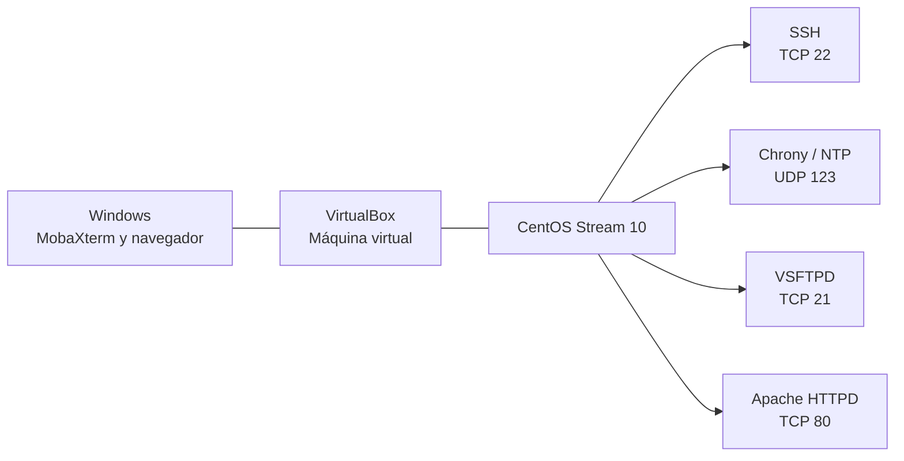

# Arquitectura, topología y matriz de servicios

## 1. Objetivo

Organizar la documentación de las prácticas realizadas con CentOS Stream 10 para levantar servicios de red: SSH, NTP, FTP y HTTP.

## 2. Topología lógica



## 3. Datos documentados del entorno

| Elemento | Dato que consta en los registros |
|---|---|
| Sistema operativo | CentOS Stream 10 |
| Virtualización | VirtualBox |
| Cliente de administración y FTP | MobaXterm |
| Servidor FTP | VSFTPD |
| Usuario FTP | ftpandres |
| IP usada en la prueba FTP | 10.21.165.107 |
| Directorio FTP | /home/ftpandres/archivos |
| Servidor NTP | Chrony |
| Red permitida en chrony.conf | 192.168.1.0/24 |
| Servidor web | Apache HTTPD |
| Directorio web | /var/www/html |

Los datos corresponden a sus respectivas prácticas; no se asume que pertenecen a la misma configuración de red.

## 4. Matriz de puertos y servicios

| Servicio | Protocolo | Puerto | Función |
|---|---|---:|---|
| SSH | TCP | 22 | Administración remota |
| NTP | UDP | 123 | Sincronización de hora |
| FTP - control | TCP | 21 | Conexión y comandos FTP |
| FTP - pasivo | TCP | Rango configurado en VSFTPD | Transferencia de datos en modo pasivo |
| HTTP | TCP | 80 | Acceso a la página web |

En las notas FTP se indica que MobaXterm se configuró en modo pasivo, pero el registro no especifica el rango pasivo. Debe utilizarse el mismo rango en VSFTPD y Firewalld; no se inventa un valor como si ya estuviera configurado.

## 5. Matriz de firewall y seguridad

| Servicio | Regla de Firewalld |
|---|---|
| SSH | servicio ssh permanente |
| NTP | servicio ntp permanente |
| FTP | servicio ftp permanente |
| HTTP | servicio http permanente |

### SELinux

- **SSH:** comprobar el estado con `getenforce`; no se requiere cambiar la política para el uso estándar del servicio.
- **NTP:** mantener SELinux activo y comprobar registros AVC si Chrony presenta denegaciones.
- **FTP:** limitar el acceso al HOME del usuario, usar `/sbin/nologin`, etiquetar solo la carpeta de transferencia como `public_content_rw_t` y habilitar únicamente el booleano FTP necesario que exista en la política instalada.
- **HTTP:** conservar el contexto estándar `httpd_sys_content_t` en `/var/www/html` mediante `restorecon`.

No se recomienda desactivar SELinux ni habilitar permisos generales como `ftpd_full_access` sin una necesidad demostrada.

## 6. Comandos generales de consulta

```bash
hostname -I
whoami
systemctl status sshd
systemctl status chronyd
systemctl status vsftpd
systemctl status httpd
sudo firewall-cmd --list-all
getenforce
```
