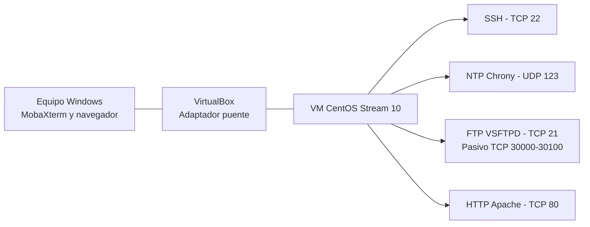

# Arquitectura, topología y matriz de servicios

## 1. Objetivo

Documentar la puesta en marcha y validación de SSH, NTP, FTP y HTTP en una máquina virtual CentOS Stream 10. La administración se realiza desde Windows y los clientes acceden mediante la red configurada en VirtualBox.

## 2. Topología lógica



La topología representa la arquitectura lógica. La IP y la máscara de la VM deben registrarse después de consultar la configuración real de red.

## 3. Datos del entorno

| Elemento | Dato que se debe registrar |
|---|---|
| Sistema | CentOS Stream 10 |
| Virtualizador | Oracle VirtualBox |
| Adaptador | Puente, si la red del laboratorio lo permite |
| IP de la VM | Consultar con ip -br -4 addr |
| Interfaz de red | Consultar con ip route |
| Red/CIDR | Confirmar con la máscara real |
| Cliente | Windows |
| Cliente FTP | MobaXterm |
| Usuario de administración | Cuenta normal con sudo |
| Usuario FTP | ftpandres, sin privilegios administrativos |

**Importante:** la IP 10.21.165.107 fue utilizada en una prueba FTP anterior. Debe verificarse de nuevo porque puede cambiar. La red 192.168.1.0/24 que figuraba en el README anterior no se debe reutilizar sin confirmar que sea la red actual.

## 4. Matriz de puertos y servicios

| Servicio | Protocolo | Puerto | Uso | Regla Firewalld |
|---|---|---:|---|---|
| SSH | TCP | 22 | Administración remota | service ssh |
| NTP | UDP | 123 | Sincronización de hora | service ntp |
| FTP control | TCP | 21 | Inicio de sesión y comandos | service ftp |
| FTP datos activo | TCP | 20 | Canal de datos en modo activo | Solo si se utiliza ese modo |
| FTP datos pasivo | TCP | 30000-30100 | Transferencia en modo pasivo | Rango configurado |
| HTTP | TCP | 80 | Sitio web | service http |
| HTTPS | TCP | 443 | Web cifrada | Solo cuando TLS esté configurado |

Abrir solo los puertos necesarios. La regla FTP debe coincidir con el rango pasivo configurado en VSFTPD. No abrir el puerto 443 sin haber configurado HTTPS.

## 5. Matriz de seguridad

| Servicio | Control de seguridad | Verificación |
|---|---|---|
| General | SELinux en Enforcing | getenforce |
| General | Firewalld activo | systemctl is-active firewalld |
| SSH | Acceso con cuenta normal; root remoto deshabilitado | sshd -T; whoami |
| NTP | Clientes limitados por allow a la red local | /etc/chrony.conf |
| FTP | Usuario sin shell ni sudo | getent passwd; sudo -l -U |
| FTP | Usuario encerrado en HOME | chroot_local_user=YES |
| FTP | Escritura solo en subcarpeta archivos | ls -ld; prueba de subida |
| FTP | Permisos SELinux específicos | getsebool ftp_home_dir |
| HTTP | Contenido con etiqueta httpd_sys_content_t | ls -Z /var/www/html |

## 6. Preparación y comandos generales

Consultar información de red:

```bash
ip -br -4 addr
ip route
hostname -I
```

Consultar Firewalld y SELinux:

```bash
systemctl is-active firewalld
sudo firewall-cmd --get-active-zones
sudo firewall-cmd --list-all
getenforce
sestatus
```

Los comandos deben ejecutarse con la cuenta administrativa del laboratorio y sudo cuando corresponda.
