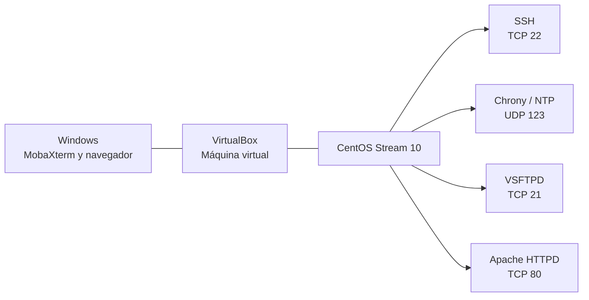

# Arquitectura, topología y matriz de servicios

## 1. Objetivo

Organizar la documentación de las prácticas realizadas con CentOS Stream 10 para levantar servicios de red: SSH, NTP, FTP y HTTP.

## 2. Topología lógica



Windows se utiliza como equipo cliente. MobaXterm permite conectarse por SSH y realizar transferencias FTP; el navegador permite consultar la página publicada por Apache.

## 3. Datos documentados del entorno

| Elemento | Dato que consta en los registros |
|---|---|
| Sistema operativo | CentOS Stream 10 |
| Virtualización | VirtualBox |
| Cliente de administración y FTP | MobaXterm |
| Servidor FTP | VSFTPD |
| Usuario FTP | ftpandres |
| IP usada en la prueba FTP | 10.21.165.107 |
| Directorio FTP | /home/ftpandres/archivos |
| Servidor NTP | Chrony |
| Red permitida en chrony.conf | 192.168.1.0/24 |
| Servidor web | Apache HTTPD |
| Directorio web | /var/www/html |

La IP FTP y la red NTP se copian de los registros originales de cada práctica; no se asume que pertenezcan a la misma configuración de red.

## 4. Matriz de puertos y servicios

| Servicio | Protocolo | Puerto | Función |
|---|---|---:|---|
| SSH | TCP | 22 | Administración remota |
| NTP | UDP | 123 | Sincronización de hora |
| FTP - control | TCP | 21 | Conexión y comandos FTP |
| HTTP | TCP | 80 | Acceso a la página web |

En las notas FTP se indica que MobaXterm se configuró en modo pasivo, pero el registro no especifica un rango pasivo de puertos. Por esa razón no se inventa un rango en esta matriz.

## 5. Matriz de firewall y seguridad

| Servicio | Configuración que consta en GitHub |
|---|---|
| SSH | Se agregó el servicio ssh de forma permanente y se recargó Firewalld |
| NTP | Se agregó el servicio ntp de forma permanente y se recargó Firewalld |
| FTP | Se agregó el servicio ftp y se guardó de forma permanente |
| HTTP | Se agregó el servicio http de forma permanente y se recargó Firewalld |

**SELinux:** el objetivo de la práctica incluye revisar la seguridad con SELinux. Sin embargo, en los README originales no constan modificaciones específicas de SELinux ni salidas de comandos que demuestren su estado. No se presentan como realizadas acciones que no aparecen en el registro.

## 6. Comandos generales de consulta

```bash
hostname -I
whoami
systemctl status sshd
systemctl status chronyd
systemctl status vsftpd
systemctl status httpd
sudo firewall-cmd --list-all
getenforce
```

Estos comandos permiten consultar datos de red, usuario, servicios, firewall y estado de SELinux.
